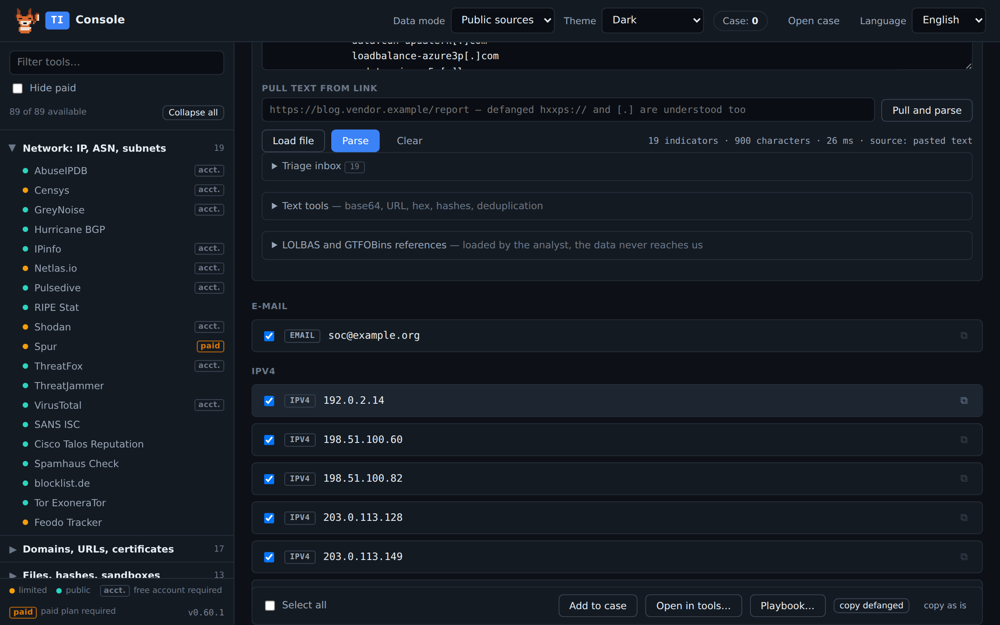
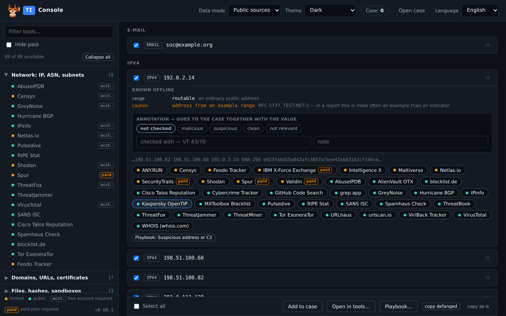
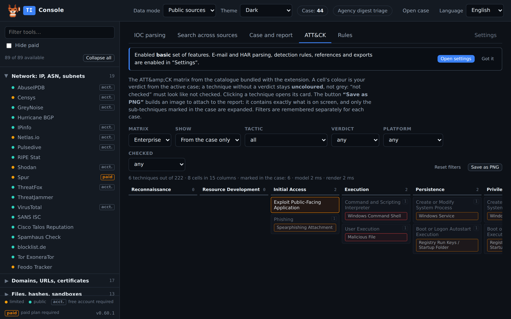
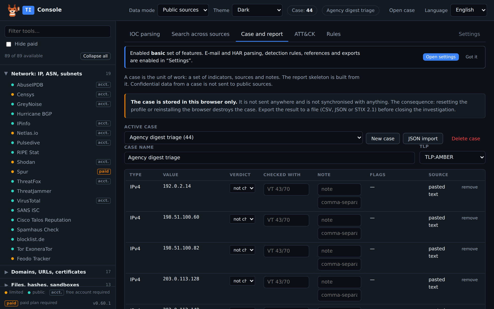
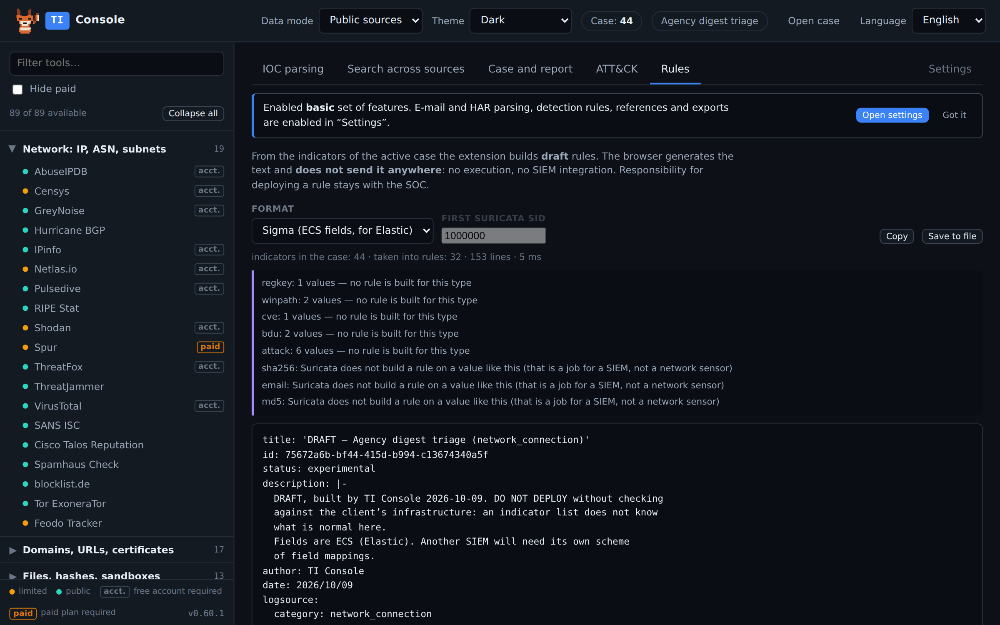

# TI Console

**A threat-intelligence analyst's workbench inside the browser. Everything
runs locally: parsing, tool selection, the case and the report.**

TI Console takes any text an analyst is handed — a vendor report, a log,
an `.eml` file, a HAR export, a PDF, a screenshot — and pulls the
indicators out of it. Then it lines those indicators up against the
services worth checking them in, keeps a case, maps it onto MITRE ATT&CK
and writes the skeleton of the report.

No server. No account. No telemetry. Nothing leaves the machine unless
you click something that opens a site.



---

## Why it exists

An analyst who receives a report does the same forty minutes of work
every time: copy an indicator, paste it into a service, read the verdict,
copy the next one, keep a list somewhere, and at the end write a document
that says what was found and what to do about it. The browser is already
where all of that happens, so the tool lives there too.

The design has one hard constraint that shapes everything else:
**the extension must never be the thing that leaks a client's indicator.**
That is why there is no server, no automatic enrichment, no background
traffic, and why "client data" mode exists.

---

## What it does

**Pulls indicators out of anything.** Paste text, load a file, or parse
the open page. It extracts IPv4/IPv6, CIDR, domains, URLs, e-mail
addresses, MD5/SHA-1/SHA-256/SHA-512, CVE, ASN, registry keys, Windows
paths, BTC/ETH wallets, onion addresses, Telegram channels, Discord
invites and MITRE ATT&CK technique IDs — 21 types in total.

Defanged values are understood automatically: `hxxp://`, `1.1.1[.]1`,
`example(dot)com`, and the Russian-language spellings used in local
reports. A SHA-256 broken across two lines by a PDF is glued back
together. Page footers, stamps and reference sections are filtered out
as boilerplate, so `report.pdf` and `main.js` do not become domains.

**Parses a whole e-mail.** An `.eml` file is broken down into the
Received path, SPF/DKIM/DMARC discrepancies, attachments with their
hashes, and the embedded message if there is one. Headers in KOI8-R and
windows-1251 are decoded correctly.

**Parses a HAR export.** Server addresses, redirect chains and an
allow-listed set of headers. Response bodies, cookies and authorisation
headers never enter the parse.

**Matches indicators to tools.** 89 OSINT and threat-intel services in
9 categories, each tagged with what it will see: `public` (submitting the
value discloses it), `limited` (a commercial service sees the query but
does not publish it), free / account / paid.



**Highlights indicators on any page** and offers the matching services in
a card, without leaving the report you are reading.

**Keeps a case.** Indicators, verdicts, what each was checked with,
notes, sources and a timeline of the investigation. Exports to CSV, JSON
and STIX 2.1.



**Maps the case onto ATT&CK.** The full Enterprise matrix from a
catalogue bundled with the extension — no network call. Cell colour is
your verdict; techniques without one stay uncoloured, because "not
checked" must look like not checked. Exports as a picture for the report
and as a layer for ATT&CK Navigator.



**Writes the report skeleton.** Ten sections with the indicator table,
the timeline and the ATT&CK section already filled in from the case.



**Drafts detection rules** — Sigma (ECS fields), Suricata, YARA. They are
drafts on purpose: the browser generates the text and does not send it
anywhere. No execution, no SIEM integration. Responsibility for deploying
a rule stays with the SOC.

---

## Client-data mode

One switch in the header. In **client data** mode every tool whose
exposure is `public` disappears from the results: submitting a value
there would be the same as publishing it. What remains are services that
see the query but do not publish it.

If your SOC distributes a list of own and client ranges through browser
policy (`ownRanges`, `ownDomains`), values inside those ranges are
flagged in the results and are never sent to public services: bulk open
skips them, playbooks skip them, and opening one by hand asks for
confirmation. The list itself is never transmitted — it is read from
policy and compared on your machine.

---

## Interface language

English by default, Russian available from the selector in the top-right
corner. The choice is stored in `storage.local` and survives a restart.

---

## Install

**From a store** — once published, links will be here.

**From source, Chrome / Chromium:**

```bash
python3 tools/build.py --chrome      # produces dist/ti-console-chrome.zip
```

then `chrome://extensions` → Developer mode → **Load unpacked** →
select `dist/chrome-unpacked`.

**From source, Firefox:**

```bash
python3 tools/build.py --firefox     # produces dist/ti-console.xpi
```

A release build of Firefox installs only signed add-ons, so for local
testing use `about:debugging` → This Firefox → **Load Temporary Add-on**
and pick `extension/manifest.json`.

Requirements: Python 3.11+. No npm install, no bundler, no build step for
the extension itself — the sources in `extension/` are what runs.

---

## Permissions, and why each one is there

| Permission | What it is for |
|---|---|
| `storage` | the case, settings and chosen language, in your browser profile |
| `contextMenus` | "parse selection" in the right-click menu |
| `activeTab` | parsing the current page, on an explicit click, for that one tab |
| `scripting` | highlighting and the on-page card, injected on demand rather than as a permanent content script |
| `tabs` | opening a chosen service in a new tab; reading the current page address for capture |
| `notifications` | short result notices when the extension tab is not on screen |
| `sidePanel` (Chrome) | the side panel with tool suggestions |
| `dns`, `browserSettings` (Firefox) | local name resolution; dark colour scheme for page content |
| `<all_urls>` — **optional** | requested only when you turn on page capture, and refusable |
| three LOLBAS/GTFOBins hosts — **optional** | requested when you press "Load", for one static file each |

Nothing is requested at install time beyond the first group.

---

## Privacy

The extension has no server, no accounts, no synchronisation and no usage
statistics. It makes exactly three kinds of network request, all of them
on your explicit action: opening a service you chose, fetching a page by
a URL you typed, and downloading the two reference files above.

Full text: [PRIVACY.md](PRIVACY.md).

---

## Building and verifying

```bash
python3 tools/build.py --chrome      # Chrome Web Store ZIP + unpacked copy
python3 tools/build.py --firefox     # Firefox XPI for AMO
```

Both builds are deterministic: file timestamps inside the archive are
fixed, so rebuilding unchanged sources produces a byte-identical file you
can compare by hash. This matters for store review — the package can be
reproduced from the sources in this repository.

---

## Status

Version 0.61.0. The extension is feature-complete for the workflow it
describes and is in daily use. Interface localisation covers 1532 strings
in English and Russian.

See [CHANGELOG.md](CHANGELOG.md).

---

## Contributing

Bug reports and ideas are welcome — see [CONTRIBUTING.md](CONTRIBUTING.md).
Security issues: [SECURITY.md](SECURITY.md).

## Licence

See [LICENSE](LICENSE).
